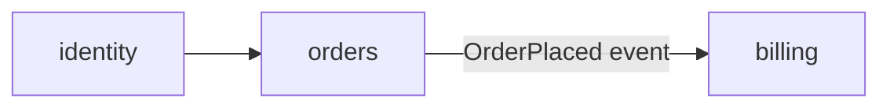

# Templates

## docs/product.md
```markdown
# <Product name>

_Last updated: YYYY-MM-DD_

## Vision
One or two sentences.

## Problem
Who hurts, how, and why current alternatives fall short.

## Personas
### <Name, role>
- Goal:
- Pain:
- Usage: daily / weekly / ...

## Value proposition
The core promise in one sentence.

## Business model
- Revenue: <subscription / usage / fee…>, pricing: <rough>
- Acquisition: <channel>
- Competitors: <name>, how we differ

## Riskiest assumptions
| # | Assumption | Cheapest test | Status |
|---|------------|---------------|--------|
| A-1 | <must be true> | <how to test> | Open / Validated / Invalidated |

## Product principles
1. <principle>: what it means when trading off

## Success metrics
- North star: <metric, target>
- Supporting: <metric>, <metric>

## Roadmap
| Item | Tests assumption | Status | PRD |
|------|------------------|--------|-----|
| <feature> | A-1 | Idea / Specced / Building / Built / Shipped | docs/prd-x.md |

## Non-goals
- <what we deliberately won't do>

## Constraints
Budget, deadlines, team, compliance, markets and languages. Hosting: see docs/architecture/stack.md.
```

## docs/glossary.md
```markdown
# Glossary (ubiquitous language)

Use these exact terms in code, UI, tests and PRDs.

| Term | Meaning | Context | Avoid saying |
|------|---------|---------|--------------|
| Order | A customer's confirmed request to buy one or more products | orders | purchase, cart |
```

## docs/architecture/context-map.md
````markdown
# Context map

| Context | Owns (data, terms) | API module | Web feature | Depends on |
|---------|--------------------|------------|-------------|------------|
| identity | users, sessions, roles | modules/identity | features/auth | none |



## Relationships
- orders → identity: synchronous, through identity's public API (`getActor`).
- orders → billing: `OrderPlaced` event, delivered via the outbox and cron.
````

## docs/architecture/stack.md
Copy `default-stack.md` (the hosting facts, stack and commands sections), with every `<…>` filled in and each choice linked to its ADR.

## docs/adr/NNNN-slug.md
```markdown
# NNNN. <Decision title>

- Status: Accepted | Superseded by NNNN
- Date: YYYY-MM-DD

## Context
## Decision
## Alternatives considered
- <option>: why not
## Consequences
```

## CLAUDE.md (repo root)
Keep it under 40 lines. Merge with any existing content rather than overwriting it.
```markdown
# <Product name>

<One-sentence vision.> Full context: docs/product.md.

## Before you work
- Stack and hosting: docs/architecture/stack.md (source of truth; don't re-decide)
- Domain terms: docs/glossary.md (use them exactly)
- Module boundaries: docs/architecture/context-map.md
- Decisions: docs/adr/

## Commands
Everything runs in Docker through `./dev`; the host has no Node.
- `./dev install`, `./dev up`, then `./dev seed`: local app at http://localhost:5173
- `./dev test [paths]`: Vitest in Docker (the result that counts)
- `./dev e2e`: Playwright acceptance tests
- `./dev lint && ./dev typecheck`, or `./dev check` for everything

## Workflow
New feature: /new-requirement → /build-requirement → /ship-requirement. Small change or bug fix: /small-change.
```
