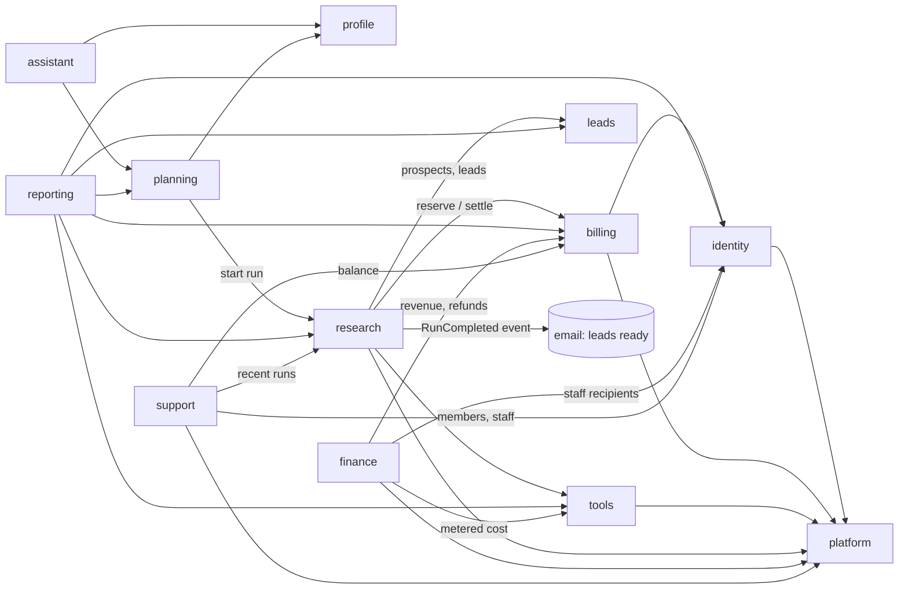

# Context map

| Context | Owns (data, terms) | API module | Web feature | Depends on |
|---------|--------------------|------------|-------------|------------|
| identity | Businesses, Members, roles (owner, member), Staff flag, sessions, invites | modules/identity | features/auth, features/team | none |
| billing | Credit wallet, Ledger entries, Credit packs, purchases (Stripe), Reservations, Settlements | modules/billing | features/credits | identity |
| profile | Business Profile, Products | modules/profile | features/profile | identity |
| assistant | Conversations and messages (welcome chat, planning chat) | modules/assistant | features/assistant | identity, profile, planning |
| planning | Goals, Plans, Ideal Customer Profile, Target segments, Search area | modules/planning | features/plans | identity, profile, research |
| research | Research flows, Flow templates, Steps, Research runs, Checkpoints, Guardrails, the agent loop | modules/research | features/flows | planning, tools, leads, billing |
| tools | Tool catalog, Rate card, provider adapters (Apify, Google Places, Overpass, Firecrawl, Apollo, ZeroBounce, Twilio Lookup, Claude), Tool calls (metering), provider health | modules/tools | features/backoffice (tools) | none |
| leads | Prospects, Leads, Contacts, Sources, verification results, Fit score, Evidence, Pitch, Lead lists, Feedback, CSV export (Removal list later) | modules/leads | features/leads | identity |
| platform | Platform settings (encrypted secrets), Audit log, analytics events, email sending | modules/platform | features/backoffice (settings, audit) | none |
| finance | Expenses (Recurring bills, price versions, One-off expenses), Provider invoices, Budget and budget alerts, the P&L (computed from billing revenue, tools metering and expenses) | modules/finance | features/finance (in the back office) | billing, tools, identity, platform |
| support | Tickets, Replies, Internal notes, the Waiting queue, ticket emails | modules/support | features/support (Help in the app; Support desk in the back office) | identity, research, billing, platform |
| reporting | Read-only Staff dashboard and customer list, built from other contexts' public queries | modules/reporting | features/backoffice (dashboard, customers) | identity, billing, planning, research, tools, leads |

The staff back office is not a context: it is a web feature (`features/backoffice`) that uses the staff-only endpoints of identity, billing, tools, research, platform, reporting, finance and support.

## Relationships
- **assistant → profile, planning:** synchronous calls to their public use cases (update the Business Profile, draft a Plan). The assistant owns the conversation, never the data it fills in.
- **planning → research:** `StartRun(planId)` through research's public API. Planning owns *what* to find; research owns *how*.
- **research → tools:** calls Tools only through the tools module's `ToolRunner` port, which meters every Tool call and returns its cost in credits.
- **research → billing:** `reserve(businessId, runId, credits)` before a run, `settle(runId, actualCredits)` after. A run cannot start without a successful Reservation.
- **research → leads:** writes Prospects and qualified Leads through leads' public API (merge, verify, score). Leads owns the records, their Sources and the Removal list check.
- **Events:** `RunCompleted` and `RunFailed` (research) trigger the "leads ready" email and analytics. They go through the outbox and the worker queue.
- **platform:** every context may read Platform settings (`SettingsReader`, keys decrypted on use) and write the Audit log and analytics events; platform depends on nothing.
- **finance:** reads billing (`revenueForMonth`), tools (`meteredCostByProvider`, `providers`) and identity (`staffRecipients`) through public query functions, and writes only its own tables plus the Audit log, analytics and email through platform. Budget alerts go through the outbox (`BudgetAlertRecorded`, consumed by finance's own `finance-events` queue). Nothing depends on finance.
- **support:** reads identity (`memberSummaries`, `staffMembers`, `staffRecipients`, `businessNames`), research (`recentRunsForBusiness`, `runForSupport`) and billing (`balanceFor`) through public query functions; writes only its own tables plus the Audit log, analytics and email through platform. Ticket emails go through the outbox to its own `support` queue. Starting Acting as from a Ticket calls identity's existing endpoint with a `ticketNumber`. Nothing depends on support (ADR 0021).
- **reporting:** reads other contexts through their public query functions only; nothing depends on reporting.
- **No cycles:** platform, tools and identity depend on nothing except platform; leads depends only on identity.
